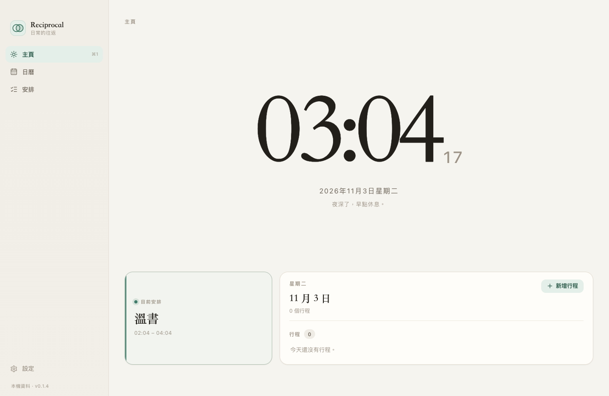
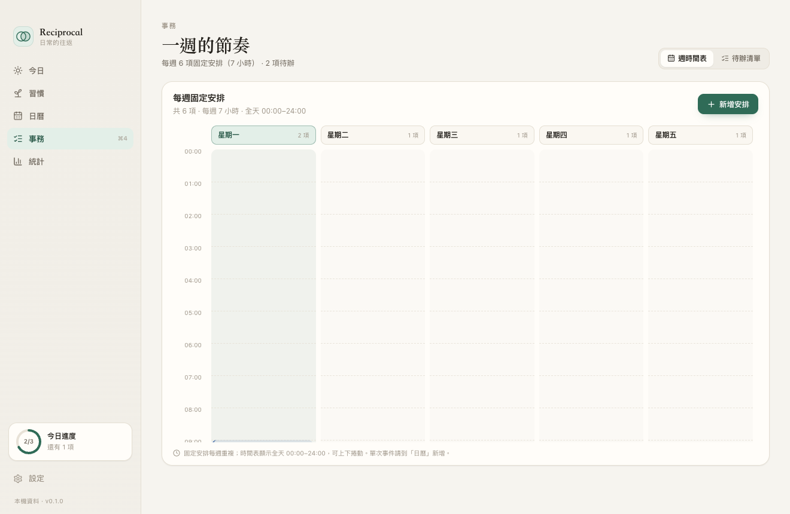
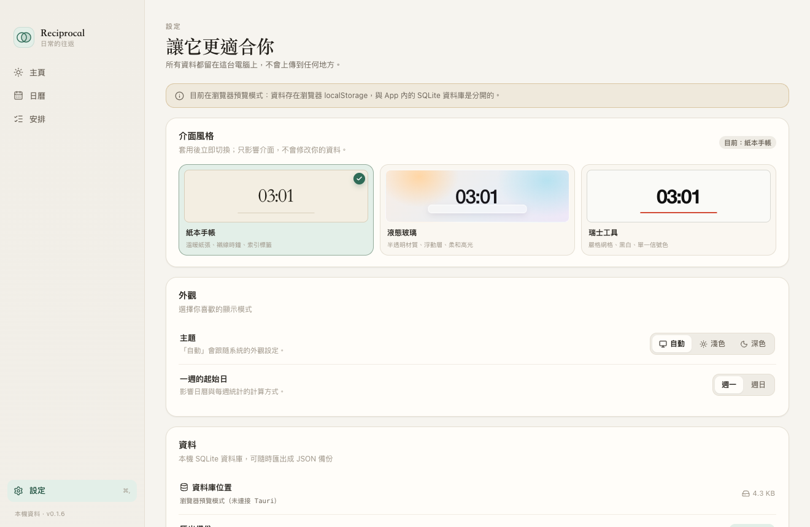
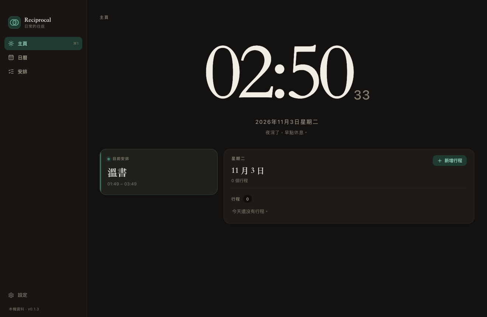
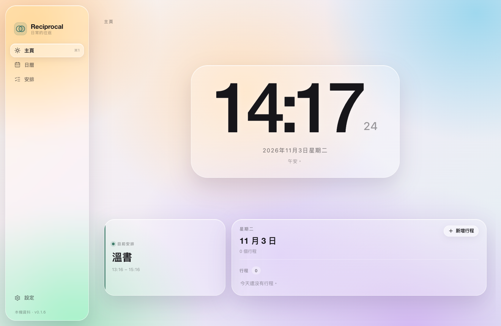
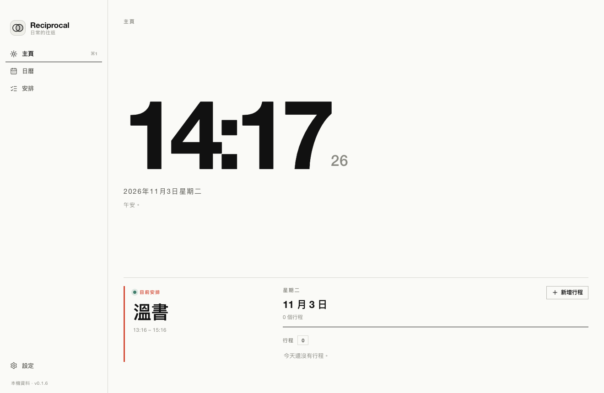
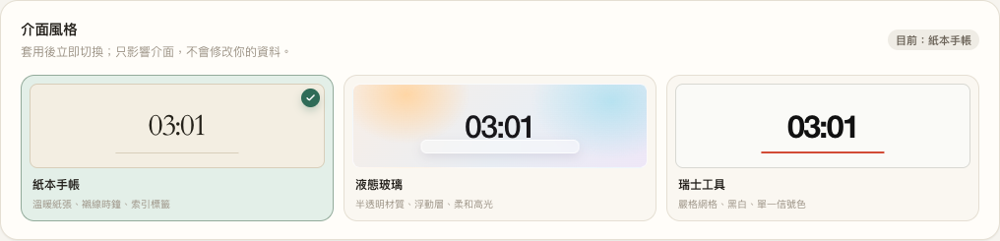
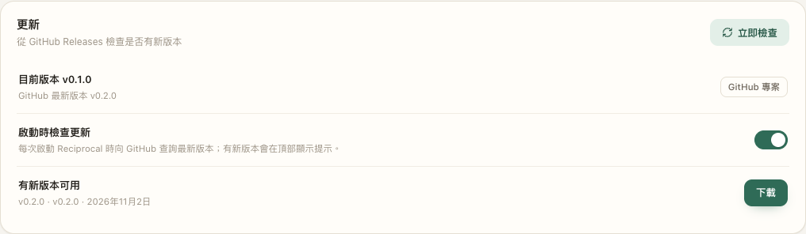
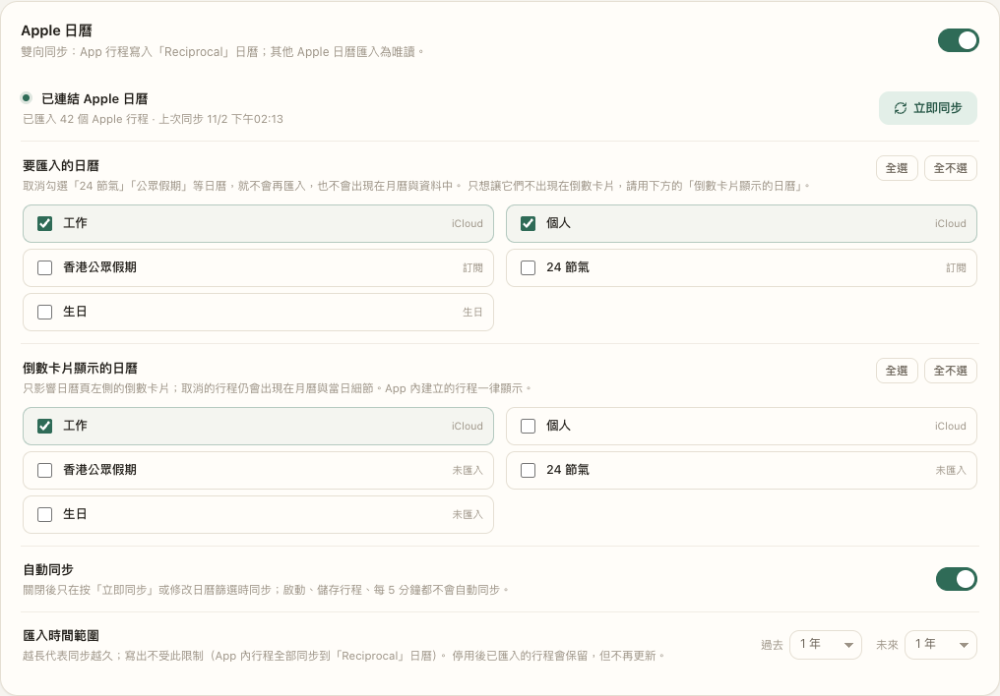
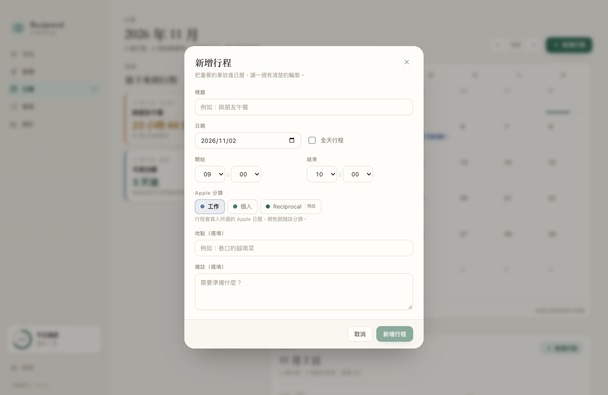

# Reciprocal

> 把每天的小事記錄下來，讓生活慢慢回到自己手上。

Reciprocal 是一個為個人打造的桌面應用：安排行程、追蹤待辦。主頁是大字時鐘，下方顯示目前固定安排與今天的明細。所有資料都存在你自己的電腦上，完全離線。

- GitHub：<https://github.com/david0304git/reciprocal>
- 下載：<https://github.com/david0304git/reciprocal/releases>



## 平台與下載

| 平台 | 需求 | 下載 |
| --- | --- | --- |
| **macOS** | macOS 10.15+（Apple 日曆同步需 macOS 14+） | `Reciprocal-<version>-macos-arm64.zip` |
| **Windows** | Windows 10／11 x64，WebView2（Windows 11 內建；10 可能由安裝檔下載） | `Reciprocal_<version>_x64-setup.exe` |

Windows 版與 macOS 版共用同一份 Rust／React 程式碼與 SQLite 格式；**Apple 日曆同步僅限 macOS**（EventKit），Windows 版其餘功能（主頁、日曆、週時間表、安排、備份、更新檢查）完整可用。

Windows 安裝檔未簽章，SmartScreen 可能提示：點「更多資訊 → 仍要執行」。資料庫位置為 `%APPDATA%\com.lutszhong.reciprocal\reciprocal.db`。

從原始碼建置 Windows 版：

```powershell
npm ci
npx tauri build --bundles nsis
```

產物在 `src-tauri/target/release/bundle/nsis/`。

## 功能

| 頁面 | 內容 |
| --- | --- |
| **主頁** | 大字時鐘（時:分＋秒）、日期、問候語；左下方顯示今天最近的固定安排，右下方只顯示今天的行程明細 |
| **日曆** | 月視圖、左側行程倒數（剩餘天／小時／分鐘，卡片區局部滾動＋可見滾動條）、可選 Apple 日曆分類與顏色；點選日期可開啟當天行程並編輯，當日明細卡在主頁 |
| **安排** | **週時間表**（星期一至五 × 全天 00:00–24:00，24 小時制時間選擇，可捲動）＋待辦清單分頁（清單／看板、拖放、優先級、標籤、篩選） |
| **設定** | **介面風格（紙本手帳／液態玻璃／瑞士工具）**、主題（自動／淺色／深色）、一週起始日、資料庫位置與大小、JSON 匯出與還原、清除所有資料、**Apple 日曆整合（選用，僅 macOS；日曆篩選為勾選式下拉選單）**、更新檢查 |

- 介面繁體中文，跟隨系統淺色／深色外觀（macOS／Windows）。
- 鍵盤快捷鍵：macOS 為 `⌘1`…`⌘3`、`⌘,`；Windows 為 `Ctrl+1`…`Ctrl+3`、`Ctrl+,`。
- macOS 採原生 Overlay 標題列（紅綠燈融入側欄）；Windows 使用系統標題列。兩者都可拖曳視窗頂部移動。

### 畫面

| 主頁 | 日曆（左側倒數） |
| --- | --- |
|  |  |

| 週時間表 | 設定 |
| --- | --- |
|  |  |

| 主頁明細 | 日曆多選下拉 |
| --- | --- |
|  |  |

| 深色模式 |
| --- |
|  |

## 介面風格

設定 → 介面風格可切換三種視覺語言，套用後立即生效並記住選擇：

| 紙本手帳 | 液態玻璃 | 瑞士工具 |
| --- | --- | --- |
|  |  |  |



- **紙本手帳**：現行預設；紙張色、襯線時鐘、索引標籤、細線
- **液態玻璃**：App 內 WebView 材質；彩色桌布、半透明面板、浮動側欄、高光邊緣（非 macOS 原生折射）
- **瑞士工具**：嚴格網格、黑白、單一信號紅、無圓角與陰影

> 液態玻璃使用 `backdrop-filter`；低階 GPU 若覺得耗電，可切回紙本或瑞士。三種風格共用同一份資料與功能。

## 技術架構

| 層 | 選擇 |
| --- | --- |
| 桌面框架 | **Tauri 2**（Rust 後端 + macOS WKWebView／Windows WebView2） |
| 前端 | React 19 + TypeScript 6 + Vite 8 |
| 樣式 | 手寫 CSS 設計系統（tokens、淺／深色主題、無 UI 框架） |
| 圖示 | lucide-react |
| 日期 | date-fns |
| 資料庫 | SQLite（`rusqlite` bundled，WAL 模式） |
| 檔案對話框 | `tauri-plugin-dialog` |
| Apple 日曆 | **EventKit**（`objc2-event-kit`），透過 macOS 系統權限存取 |

資料流：

```
React 視圖 ── invoke() ──▶ Rust command ──▶ SQLite（單一連線，Mutex）
     ▲                                          │
     └──────────── AppData（整份資料）◀─────────┘
```

每次操作只回傳被修改的那一筆，前端做局部更新；啟動時一次載入全部資料（單人使用量級：數年資料也只有數 MB），日期與統計計算都在前端以 `date-fns` 處理。

### 資料表

- `habits`（名稱、emoji、顏色、頻率、每週目標、時段、封存）
- `habit_logs`（習慣 × 日期唯一，附加備註）
- `events`（日期、開始／結束時間、全天、分類、顏色、地點；`source` 區分本機／Apple，`external_id` 對應 EventKit 行程）
- `tasks`（狀態、優先級、截止日、標籤、分類、完成時間）
- `timetable`（星期 1–5、開始／結束時間、標題、備註、顏色；每週重複的固定安排）

資料庫版本為 **v4**：v1 會自動建立 `timetable` 表（v2），v2 → v3 補上 Apple 同步欄位與待刪除佇列，v3 → v4 補上日曆 ID（供倒數卡片過濾）；舊備份（沒有 `timetable`／`source`／`externalCalendarId` 欄位）也能直接還原。
- `settings`（鍵值：`theme`、`weekStart`、`onboarded`）

## 更新檢查

「設定 → 更新」可開啟 **啟動時檢查更新**（預設關閉）。開啟後每次啟動會向 GitHub Releases 查詢最新版本；有新版本時視窗頂部會出現提示，可直接開啟 Release 下載。

也可以在設定按「立即檢查」。比對來源是公開 repo 的 GitHub Releases（沒有 Release 時退回最新 tag），不需要任何 token。



## Apple 日曆整合（選用，預設關閉）

Reciprocal 透過 Apple 的 **EventKit** 與 macOS「日曆」整合，在「設定 → Apple 日曆」開啟。



日曆篩選改為勾選式下拉選單：


建立行程時可直接選 Apple 分類：



- **開啟時**：macOS 會詢問日曆權限；同意後自動建立一個名為「Reciprocal」的日曆
- **寫出**：App 內建立的行程會同步到「Reciprocal」日曆（新增／修改／刪除）
- **匯入**：其他 Apple 日曆（iCloud／Google／Exchange）的行程會匯入 Reciprocal，標記為 `Apple` 且**唯讀**
- **匯入時間範圍**：預設過去 1 年、未來 1 年，可在設定調整（過去 1 個月～10 年、未來 1 個月～3 年）；範圍越長同步越久
- **同步時機**：啟動時、儲存／刪除行程後、每 5 分鐘，以及切回 App 時自動同步；也可按「立即同步」；可在設定關閉「自動同步」
- **權限**：若日曆權限尚未決定，同步時會自動跳出 macOS 授權提示，不需要開關一次
- **停用**：關閉開關即停止同步；已匯入的行程會保留（仍為唯讀），可手動刪除
- **權限被拒**：請到「系統設定 → 隱私權與安全性 → 日曆」開啟 Reciprocal
- **兩層日曆過濾**：
  - 「要匯入的日曆」：以勾選式下拉選單取消勾選的日曆不會匯入，行程從 Reciprocal 移除（月曆、倒數、主頁明細都看不到）
  - 「倒數卡片顯示的日曆」：只影響日曆頁左側的倒數卡片；假期等行程仍會保留在月曆與主頁明細，App 內建立的行程一律顯示
  - 若發現更早的月份沒有資料，把「匯入時間範圍 → 過去」調長（例如 3 年）再按「立即同步」即可
- 兩層設定互相獨立：例如可以匯入公眾假期放在月曆，但倒數卡片只看工作與個人行程

> 專用「Reciprocal」日曆由 App 管理：若直接在 Apple 日曆裡修改它，App 不會自動拉回變更（以 App 為準）。其他日曆則永遠是唯讀匯入。

## 開發

需求：Node 18+、Rust stable（`cargo` 在 PATH）、Xcode Command Line Tools。

```bash
npm install
npm run tauri dev
```

### 建置

```bash
npm run tauri build
# 產物：src-tauri/target/release/bundle/macos/Reciprocal.app
```

## 資料存放

- 預設位置：`~/Library/Application Support/com.lutszhong.reciprocal/reciprocal.db`
- 開發或測試時可用環境變數覆寫：

```bash
RECIPROCAL_DATA_DIR=/tmp/reciprocal-dev npm run tauri dev
```

- 第一次啟動會寫入一份示範資料（3 個習慣、8 筆打卡、2 個行程、3 項安排）；習慣資料保留但已無 UI，可在「設定 → 清除所有資料」一次清空。
- 備份是純 JSON（含版本與匯出時間），可用「設定 → 匯出」與「從備份還原」搬移或備份。

## 專案結構

```
reciprocal/
├── src/                     # React 前端
│   ├── components/          # Modal、表單、熱力圖、側欄等
│   ├── views/               # 主頁（時鐘）/ 日曆 / 安排（週時間表＋待辦）/ 設定
│   ├── lib/                 # API 封裝、型別、日期、統計、狀態
│   └── styles/app.css       # 設計系統與主題
├── src-tauri/
│   ├── src/lib.rs           # Tauri 啟動、DB 初始化、資料目錄
│   ├── src/apple.rs         # EventKit：權限、日曆、行程讀寫
│   ├── src/update.rs        # GitHub Releases 版本檢查
│   ├── Info.plist           # 日曆權限用途說明（打包時合併）
│   ├── src/commands.rs      # invoke 指令層
│   ├── src/store.rs         # CRUD、備份還原、驗證
│   ├── src/db.rs            # schema、遷移、種子資料
│   ├── src/models.rs        # 資料結構（camelCase JSON）
│   └── tauri.conf.json      # 視窗、bundle、識別碼
├── scripts/shoot.mjs        # Playwright 互動檢查與截圖
└── docs/screenshots/        # README 使用的畫面
```

## 測試與驗證

```bash
# Rust：schema、CRUD、驗證、備份還原、v1→v2 遷移、舊備份相容
cd src-tauri && cargo test --lib        # 25 tests（含 Apple 分類／顏色、同步去重、日曆／卡片過濾、匯入範圍、GitHub 版本比較／JSON 解析、v5 遷移）

# 前端：嚴格型別檢查 + 打包
npm run build

# 互動檢查（需要 dev server）：主頁時鐘、快速新增、看板拖曳、
# modal 定位、主題切換與持久化
npm run dev          # 另開一個終端
npm run shots        # 85 checks（需要本機 Chrome）
```

實機驗證方式：以 `RECIPROCAL_DATA_DIR` 啟動建置後的 `.app`，確認 SQLite 建表與種子資料寫入，並從日誌確認 WebView 載入後成功呼叫 `load_app`（`ui ready: 3 habits, 8 logs, 3 tasks`）。

## 已知限制

- Apple 日曆整合僅限 macOS 14+，需要完整日曆權限；未簽章（ad-hoc）的 `.app` 重新編譯後，macOS 可能重新詢問權限。Windows 版沒有 Apple 日曆同步。
- 「Reciprocal」專用日曆由 App 管理，在 Apple 日曆中直接修改該日曆的內容不一定會同步回 App。
- 匯入的 Apple 行程是唯讀，App 內不能編輯或刪除；請回到 Apple 日曆修改。
- Reciprocal 建立的行程若寫入你既有的 Apple 日曆（例如「工作」），在 Apple 日曆中修改它不會自動拉回 App；以 App 內的版本為準。
- 「要匯入的日曆」取消勾選後會從 Reciprocal 完全移除；只想隱藏倒數卡片請用「倒數卡片顯示的日曆」，不影響月曆資料。
- 週時間表顯示全天 00:00–24:00，內容區可上下捲動。
- 這兩層過濾只影響 Reciprocal 的顯示與匯入，不會修改或刪除你的 Apple 日曆。
- 沒有系統通知／提醒（需要額外權限與排程器）。
- 液態玻璃使用 `backdrop-filter`，在低階 GPU 上可能較耗電；可切回紙本或瑞士工具。
- 習慣與打卡 UI 已移除；既有習慣／打卡資料仍保留在 SQLite 與備份中，但目前沒有管理或打卡入口。
- 行程目前是單日事件，沒有重複規則（每週、每年）；每週重複的固定安排請用「安排 → 週時間表」。
- 固定安排只支援星期一至五（依目前需求），週末不顯示。
- 同一時段可以建立多筆安排，重疊時會疊在一起，尚未有衝突提示。
- 倒數卡片每 30 秒更新一次；只列出尚未結束的行程。
- 主頁的「目前安排」只看每週固定安排（週一至週五），不含單次行程；明細卡固定在主頁顯示今天，且只列行程，不列固定安排或到期安排。
- 安排沒有子任務與附件。
- 沒有雲端同步，這是刻意的本機優先設計。
- 尚未做 Developer ID 簽章與公證，分享給其他人需要在系統設定中允許開啟。

## 授權

個人專案，未指定開源授權。
